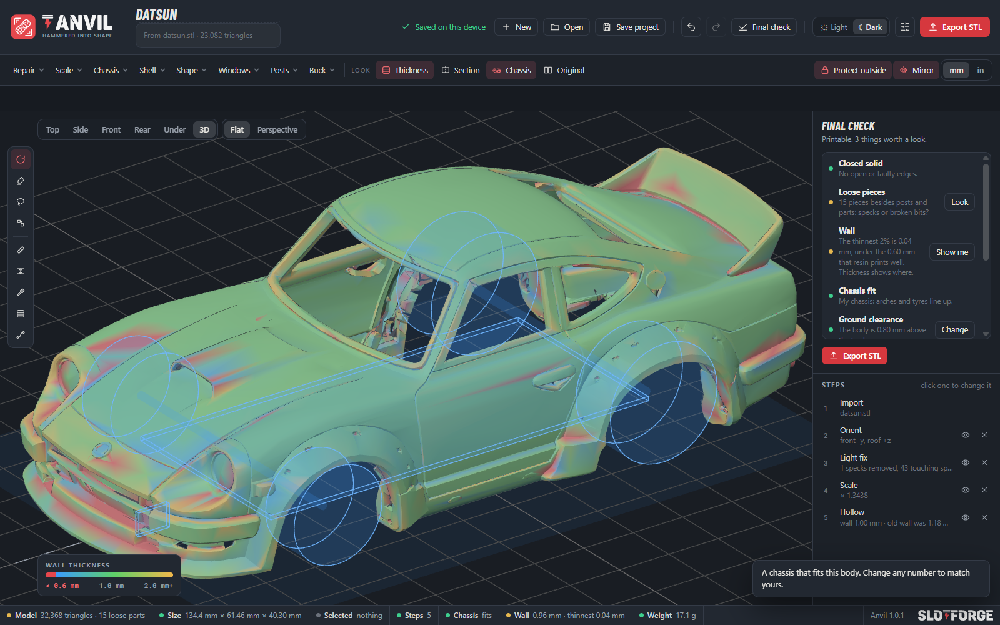
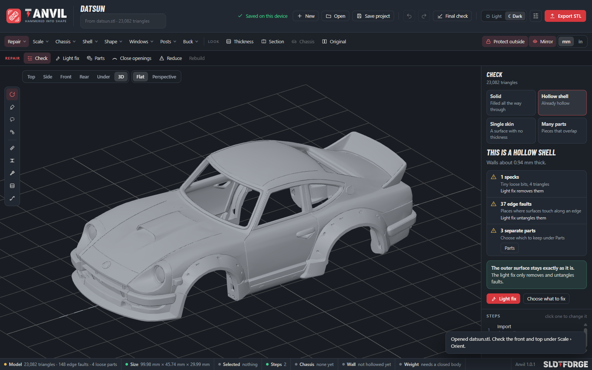
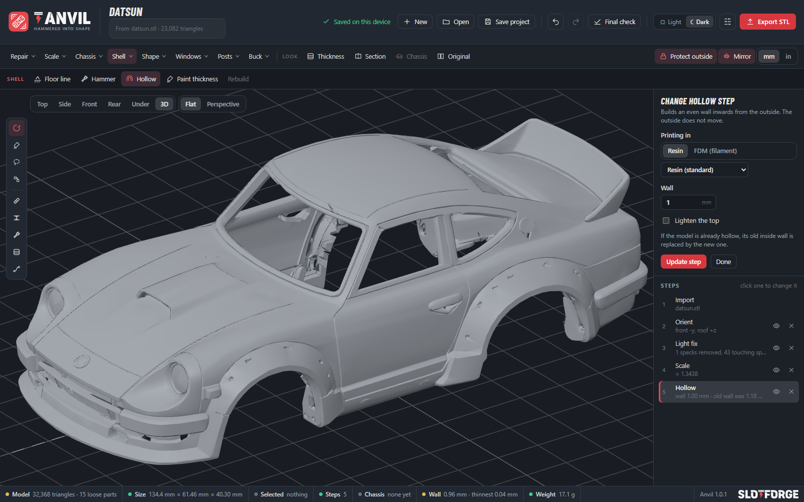
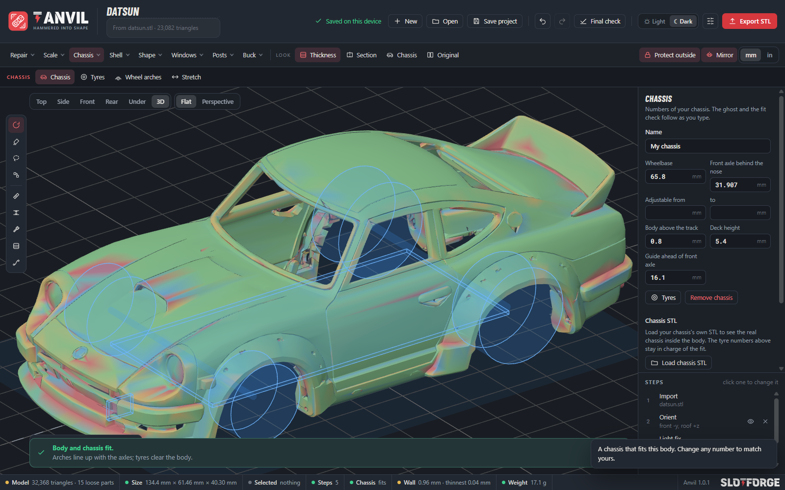
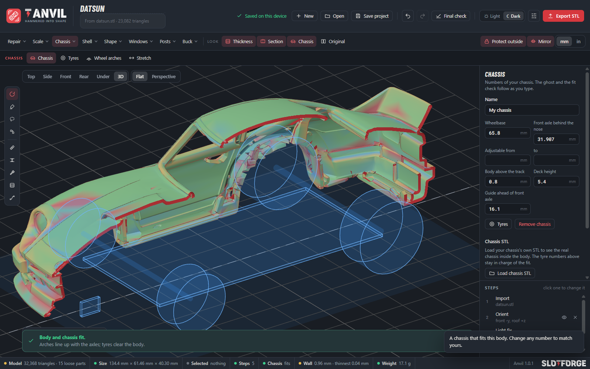
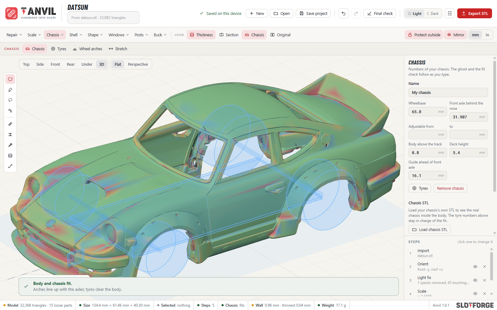
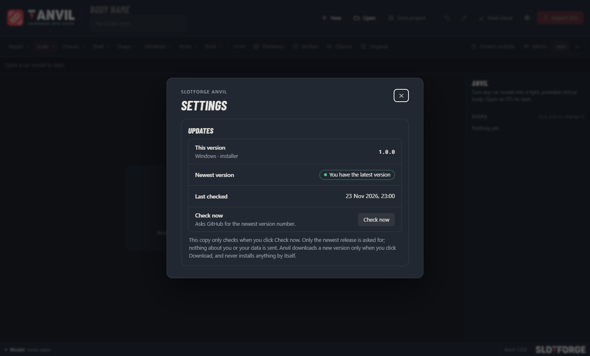

  
  

 

# SlotForge Anvil

**From any 3D car model to a body you can race.**

SlotForge Anvil turns a downloaded, scanned or modelled car into a light, printable slotcar body. Open an STL and Anvil checks it, repairs it and scales it to 1/32 or 1/24. Then hollow it to an even wall, fit it to your chassis, cut the windows and add the body posts.

Every step stays editable, so you can go back and change a wall, a wheelbase or a window at any time. A final check goes through everything that matters before you print: walls, chassis fit, ground clearance, posts and weight. Then export a print-ready STL for resin or FDM.

**A desktop app for Windows, macOS and Linux. Your models stay on your computer. No account required.**

[Download Anvil](https://github.com/theDutchmanJames/SlotForgeAnvil/releases/latest) · [See the app](#pictures-of-the-app) · [Explore the features](#features-and-functionality) · [How to install](#how-to-install) · [Report a problem](#reporting-problems)

## SlotForge App Collection

SlotForge Anvil is part of the **SlotForge App Collection**—apps for building tracks, managing your cars, designing their appearance and exploring their performance.

-  **[SlotForge Foundry](https://github.com/theDutchmanJames/SlotForgeFoundry)** — Turn slotcar track into printable parts, plan a layout and edit any STL.
-  **[SlotForge Circuit](https://github.com/theDutchmanJames/SlotForgeCircuit)** — Design slotcar tracks, including routed and FreeForm layouts, and export track data for Timing's Live Tracker.
-  **[SlotForge Timing](https://github.com/theDutchmanJames/SlotForgeTiming)** — Lap timing, race management and custom race displays for analogue slot-car tracks.
-  **[SlotForge Paddock](https://github.com/theDutchmanJames/SlotForgePaddock)** — Organize your slotcar collection, photographs, parts, setups and maintenance in a virtual garage and workshop.
-  **[SlotForge Telemetry](https://github.com/theDutchmanJames/SlotForgeTelemetry)** — Explore gearing, motors, tyres and weight, compare setups, and analyse recorded lap times.
-  **[SlotForge Decals](https://github.com/theDutchmanJames/SlotForgeDecals)** — Size and arrange artwork into decal sheets, then export a PDF for printing.
-  **[SlotForge Livery](https://github.com/theDutchmanJames/SlotForgeLivery)** — Plan paint schemes, stripes, race numbers and decals on editable 2D car templates.

Visit each app's repository for its features, downloads and getting-started guide.

## Pictures of the app

**Final check** — a Datsun body scaled to 1/32 and hollowed to a 1 mm wall, coloured by wall thickness, with the suggested chassis and tyres inside it.

| Check on import | Hollow | Chassis fit |
| :---: | :---: | :---: |
|  |  |  |
| See what the model is and what is wrong with it. | An even wall built inwards; the outside does not move. | Anvil finds the arches and suggests a chassis that fits. |

| Section | Light theme | Settings and updates |
| :---: | :---: | :---: |
|  |  |  |
| Cut through the body to check the wall. | Light or Dark, shared with the other SlotForge apps. | Anvil tells you when a new version is out. |

Click any picture to open it at full size.

## Features and functionality

Anvil works along eight menus, roughly in the order you build a body: **Repair, Scale, Chassis, Shell, Shape, Windows, Posts and Buck**. Every action becomes a step in the list on the right, which you can change, switch off or remove later. Undo and redo work as you expect.

### Open, check and repair

- **Open any STL:** drop it on the window or use Open. Anvil finds which way is front and up, and straightens a car that sits at an angle in the file.
- **A check on every import:** what kind of model it is (solid, hollow shell, single skin or many parts), how thick its walls are, and what is wrong with it.
- **Light fix:** removes specks and broken triangles, untangles touching surfaces, turns inside-out areas round and closes small holes, without moving the surface you see.
- **Rebuild:** for a badly broken model. Anvil makes it again as one clean, closed piece on a fine grid: holes, doubled and tangled triangles go, and overlapping parts merge into one. A hollow shell stays a shell. Choose Coarse, Normal or Fine detail.
- **Symmetrize:** keep the left or the right side and mirror it over the other, so both sides match exactly; the side that goes shows in red. Anvil says how much the two sides differ and where the model's middle really is.
- **Make solid:** turn a hollow shell into a solid. The inner skin and anything loose inside (seats, a dashboard) goes, the windows are closed, and the underside is cut off flat at the height you choose, wheel arches included. The inner skin shows in red first.
- **Parts, openings and reduce:** tick which loose parts to keep, close chosen openings with a flat or smooth patch, and thin out the triangles where the surface allows it.

### Scale it

- **From a scale to a scale:** Anvil guesses the file's scale from the car's length; make it **1/32 or 1/24**, or any scale you like.
- **To a length, width or height, or by a factor:** type the width your chassis or class rules ask for, or measure a known distance on the car and set the scale from that.
- **Millimetres or inches** throughout.

### Build the shell

- **Floor line:** cut the underside open at a height, or squish the lower body up onto the line so sills and valances keep their shape. On a body that is already a hollow shell, the wall is closed along the cut, so it prints solid between its skins; the same goes for Slice and Wheel arches.
- **Hollow:** an even wall built inwards from the outside, which does not move. An already-hollow model gets its old inner wall replaced. **Lighten the top** thins the wall from the sills up to the roof.
- **Paint thickness:** paint thinner or thicker spots on the wall.
- **Hammer:** hammer panels out or in like a real body panel, hold areas with a dolly, and planish out the marks. The wall is rebuilt evenly behind it.
- **Resin or FDM:** choose how you print, with the material and nozzle; the walls and the weight estimate follow.

### Fit your chassis

- **A chassis that fits:** Anvil finds the wheel arches and suggests a chassis and tyres. Type over any number to match your own chassis, shown as a blue ghost inside the body.
- **Clear warnings:** a line on the car says what does not fit (wheelbase, axle position, tyres sticking out or too tall) and fixes it with one click.
- **Your chassis library:** save a chassis and pick it again for the next body, or share it as an `.anvilchassis` file. Load your printed chassis's own STL to see the real thing inside the body.
- **Stretch and arches:** lengthen, shorten or widen the body between the arches, and cut the arches round the tyres or flare them out.
- **Tabs:** besides posts, hold the body on with tabs on the inside of the side walls: screw tabs (a flat tab with a screw hole at chassis height, with ribs) or clip tabs (a hook that snaps under the chassis edge). Click where they go; Mirror puts one on the other side.
- **LED lights:** click on a headlight or taillight for an LED pocket: a bore through the wall where the light shines out (open, or a thin window for clear resin), with a socket inside that holds the LED straight. 1.8, 3 and 5 mm presets or your own size; on a solid body, a blind hole.
- **Interior:** a flat cockpit tray shaped to the inside of the side walls, with a driver (helmet, shoulders, torso) and a steering wheel if you like, shown in amber first. Clip it in (ledges grow on the walls and the tray prints on its own beside the car) or join it to the body. Anvil warns when the helmet would touch the roof.
- **Variants:** from Final check, export other versions of the body in one go: at another scale (1:32 → 1:24) and with or without parts such as the wing or the interior. At another scale every place you set grows with the body, while the wall, posts, tabs, pins, holes and text height stay their real size. Each variant is its own STL file.
- **Clearance:** shows in red where the body comes closer than the gap you set to the tyres, the room the guide swings in, or the chassis (its STL: motor, gears, magnet). Each spot has its fix: cut the arches, cut room for the guide, or thin the wall from inside where the chassis touches. Final check lists anything that still touches.
- **Body posts:** screw posts or brass-tube sockets, mirrored, reaching from the chassis deck into the wall. Make your own post types, with a fit test piece and a loose post to print first.

### Windows and glazing

- **Windows:** draw each window with the line tool; a smooth line runs through your points. Open windows are cut through the wall with a clean edge; side windows are mirrored.
- **Window buck:** one plug for the whole cabin to vac-form a glazing insert that is glued in from the inside, with a trim line, glue margin and raised guide lines.

### Shape and finish

- **Panel lines:** shallow panel lines vanish when printed small. Anvil finds the narrow grooves on the outside (shown in red first) and makes them as deep as you set, or only those in your selection.
- **Text:** race numbers, names and letters in the fonts on your computer, raised out of the body or cut into it, following its curve. Click where it goes; with Mirror on, the other side gets it too, reading the right way round. The letters are kept in the project, so it builds the same anywhere.
- **Glue tabs:** when a body is cut into pieces (Slice keeping both, or Split off), add strips on the inside of the wall that stick out past the cut, so the other piece slides over them, lines up and has more to glue to. They show in amber before the cut; spread them evenly, add or remove them, slide each along the cut, and set their width, reach, thickness and the room left for the other wall.
- **Split off:** in the Cut off tool, keep the part instead: a wing or mirror is split from the body to print on its own, moved clear of it, with locating pins on one cut face and matching holes in the other so it glues back in the same place. Anvil puts the pins where the cut face is thickest and checks there is room behind the holes.
- **Cut off:** take off mirrors, a spoiler or other add-ons with a small cutting plane you move, turn and size in the 3D view. Only what the plane cuts free goes, it shows in red first, and the cut is closed flat. Mirrors on both sides go in one step.
- **Delete and patch, smooth, slice:** remove areas and patch the hole, smooth with a brush while sharp edges stay, or slice the body, straight or at an angle you choose, to trim it or print it in parts.
- **Add parts:** load a wing, scoop, mirror or driver, place it, and join it to the body or keep it as its own print.
- **Protect outside:** once the body is hollowed, selecting and smoothing only touch the inside of the wall.

### Check, then print

- **Look:** colour the body by wall thickness, cut a section through it, show the chassis, or compare with the original model.
- **Final check:** one list of everything that matters before printing (closed solid, loose pieces, wall thickness, chassis fit, ground clearance, posts, windows, weight and centre of weight), each with a button to the tool that fixes it.
- **Export STL:** the body, and the buck and separate parts as their own files.
- **Projects:** your last body is kept on this computer and opens again next time. **Save project** writes an `.anvil` file with the original model and every step.

### Make Anvil look the way you want

**Light** and **Dark** themes, shared with the other SlotForge apps on the same computer. The top bar and tool rows fit windows down to 1000 pixels wide.

## How to install

Open the **[latest release](https://github.com/theDutchmanJames/SlotForgeAnvil/releases/latest)** and expand **Assets**. Choose the finished app for your computer. **Desktop downloads need no Node.js, coding or terminal commands.** GitHub's automatic Source code downloads are for building it yourself.

| Your computer | Choose this download |
| --- | --- |
| **Windows · Intel/AMD 64-bit** | **Portable-x64.exe** to try the app, or **Setup-x64.exe** to install it for regular use. The **Windows-x64.zip** is the same app to unzip anywhere. |
| **macOS · Apple Silicon and Intel** | **mac-universal.dmg**, or the **.zip** of the same app. |
| **Linux · Debian/Ubuntu-based** | **.deb** (amd64 or arm64), opened with your package installer. |
| **Linux · other distributions** | **.AppImage** (x86_64 or arm64), with permission to execute enabled. |

### Windows

Start **Portable-x64.exe** to try Anvil without installing it. To install, run **Setup-x64.exe**; you can choose the folder, and it adds a desktop and Start menu shortcut.

Anvil is not code-signed. If Windows SmartScreen appears, choose **More info → Run anyway**.

### macOS

Open the **.dmg** and drag **SlotForge Anvil** to **Applications**. Anvil is not notarised: the first time, macOS blocks it. Open **System Settings → Privacy & Security** and choose **Open Anyway**.

### Linux

**Debian/Ubuntu-based systems:** open the **.deb** with your software/package installer, choose **Install**, then start Anvil from the applications menu.

**AppImage:** save the file, open **Properties → Permissions**, enable **Allow executing file as program** or your distribution's equivalent, then double-click it. AppImage support depends on your distribution and FUSE configuration; the DEB is an alternative on Debian-based systems.

### Run or build from source

See [Developing SlotForge Anvil](docs/DEVELOPMENT.md) for running the app from the code, the tests and the builds.

### Your first body

1. Choose **Open** and pick an STL of a car. The **Check** opens and says what kind of model it is.
2. If the check lists faults, choose **Light fix**.
3. Under **Scale › Scale**, make it **1:32** or **1:24** and choose **Scale**.
4. Under **Shell › Hollow**, choose resin or FDM and a wall, then **Hollow**. Switch on **Thickness** to see the wall.
5. Under **Chassis › Chassis**, choose **New chassis that fits** and type over the numbers to match your chassis.
6. Choose **Final check**, fix what it points out, then **Export STL**.

### Updating, backups and moving computers

Anvil checks for a new release when it starts and shows what's new. Choose **Download** to save the new version in your Downloads folder, or **Skip this version**. Open **Settings** (the sliders button in the top bar) to **Check now** or switch off the check at start. Your projects, library and settings stay where they are when you update.

Anvil keeps your last project, the library and its settings in its user-data folder. On Windows this is normally `%APPDATA%/SlotForge Anvil/`, on macOS `~/Library/Application Support/SlotForge Anvil`, and on Linux `~/.config/SlotForge Anvil`. **Help → Show data folder** opens it.

To keep a body safe or move it to another computer, choose **Save project**: the `.anvil` file holds the original model and every step. Share a chassis from the chassis library as an `.anvilchassis` file.

## Reporting problems

Open a [GitHub issue](https://github.com/theDutchmanJames/SlotForgeAnvil/issues) and include:

- Your app version and operating system.
- What you expected, what happened, and the steps needed to reproduce it.
- A screenshot and the exact error message, if one appears.
- For model problems: where the model came from, its size and number of triangles, and the steps in your project. Attach the `.anvil` file only if you are allowed to share the model in it.
- For print problems: your printer, resin or filament, the wall you chose and a photo of the print.

Use a small example where possible, and remove private information before sharing files.

## License and copyright

SlotForge Anvil is made by theDutchmanJames. Copyright 2026 theDutchmanJames and contributors.

SlotForge Anvil is provided under the **SlotForge Source-Available License 1.0 — No Software Sales or Paid Access**.

- Personal, educational, club and internal business use are permitted without charge.
- You may study, modify and share free copies, keeping the license and notices and identifying your modifications.
- Selling the app, including modified versions or copies bundled into paid offerings, or charging for access requires separate written permission.
- You may use or sell your own bodies, STL files and printed parts, subject to the rights in the car models you start from. This does not permit selling the app itself.
- Voluntary donations are allowed when access and use do not depend on payment.

See [LICENSE](LICENSE) for the full terms. Third-party components retain their own licenses.

Car models belong to their makers. Only use and share models you are allowed to; Anvil does not include any car models.
